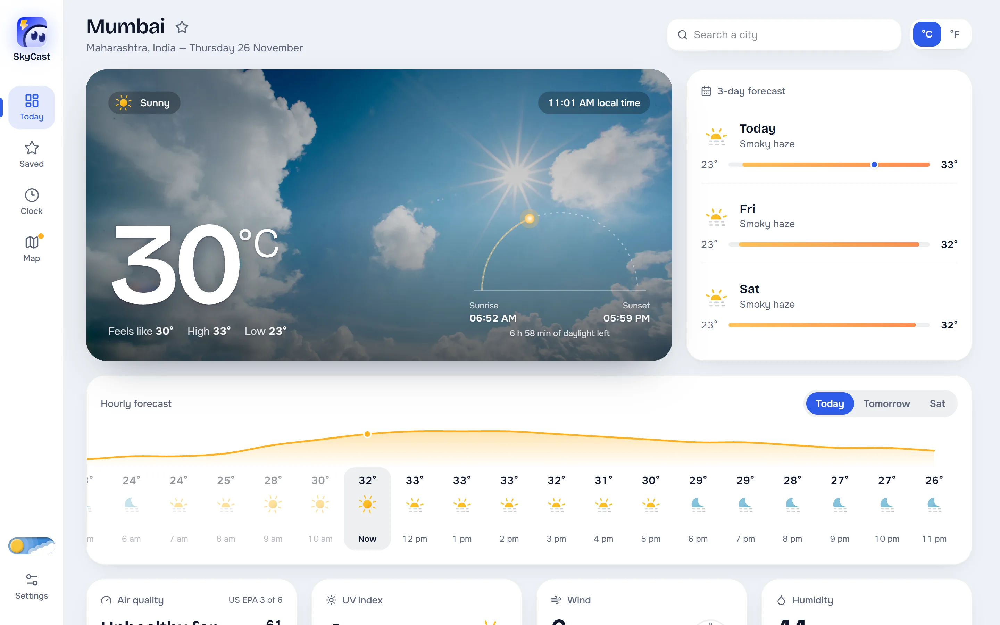
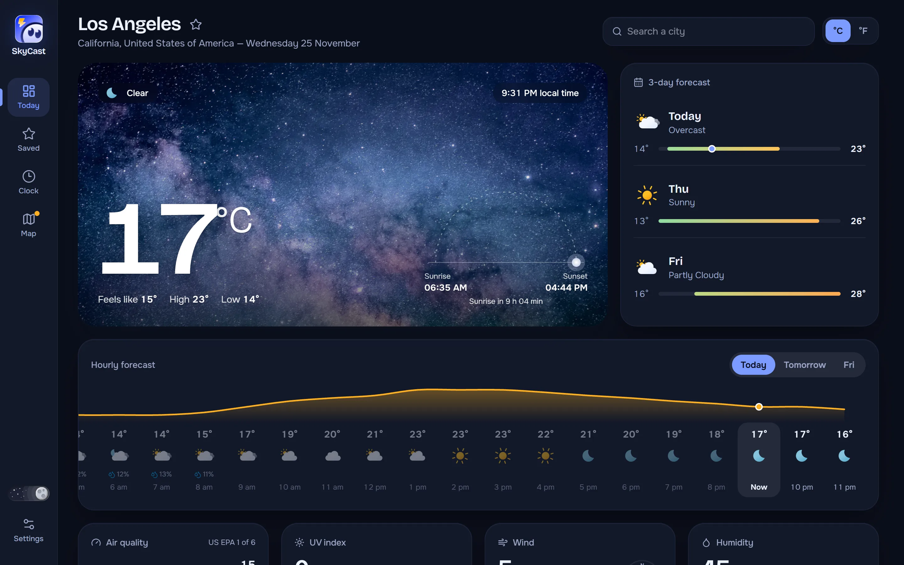
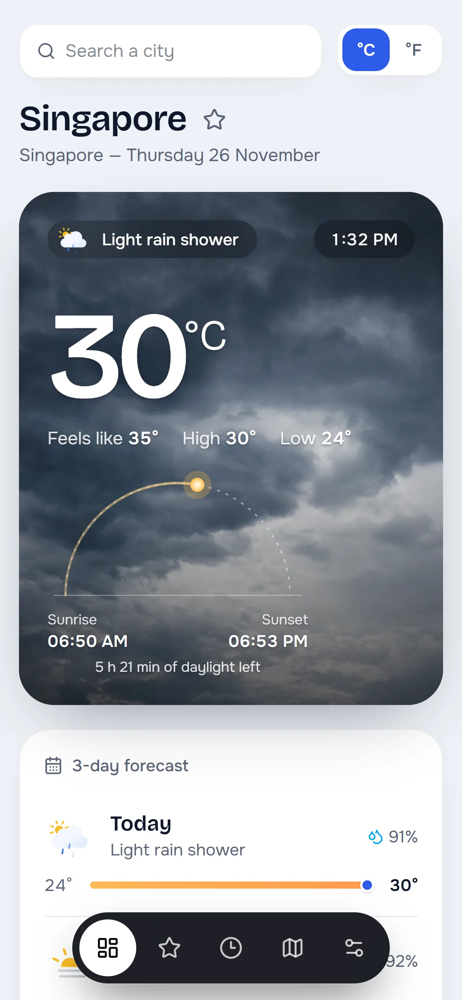
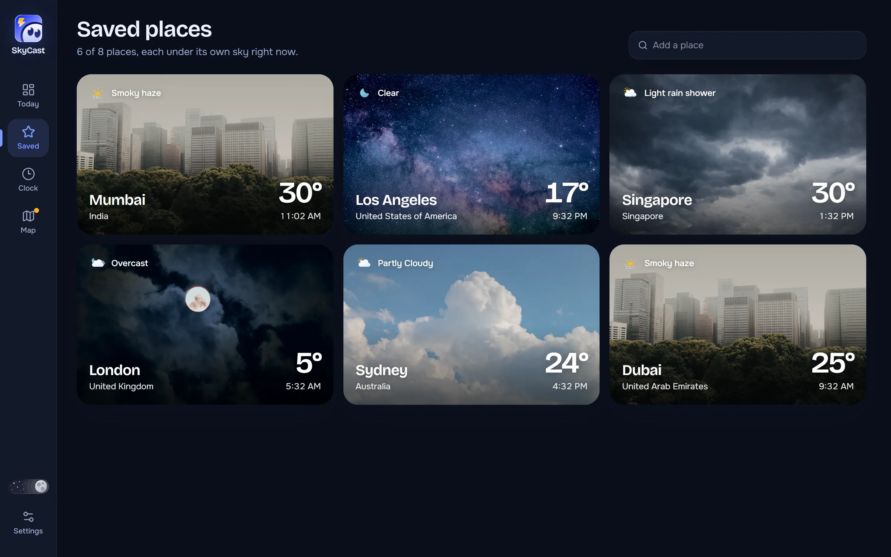
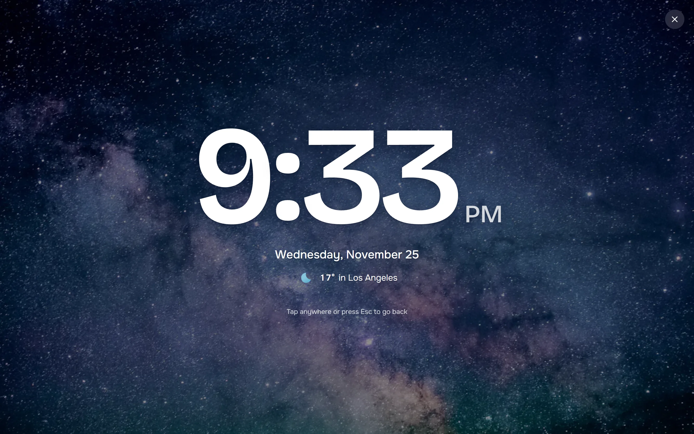
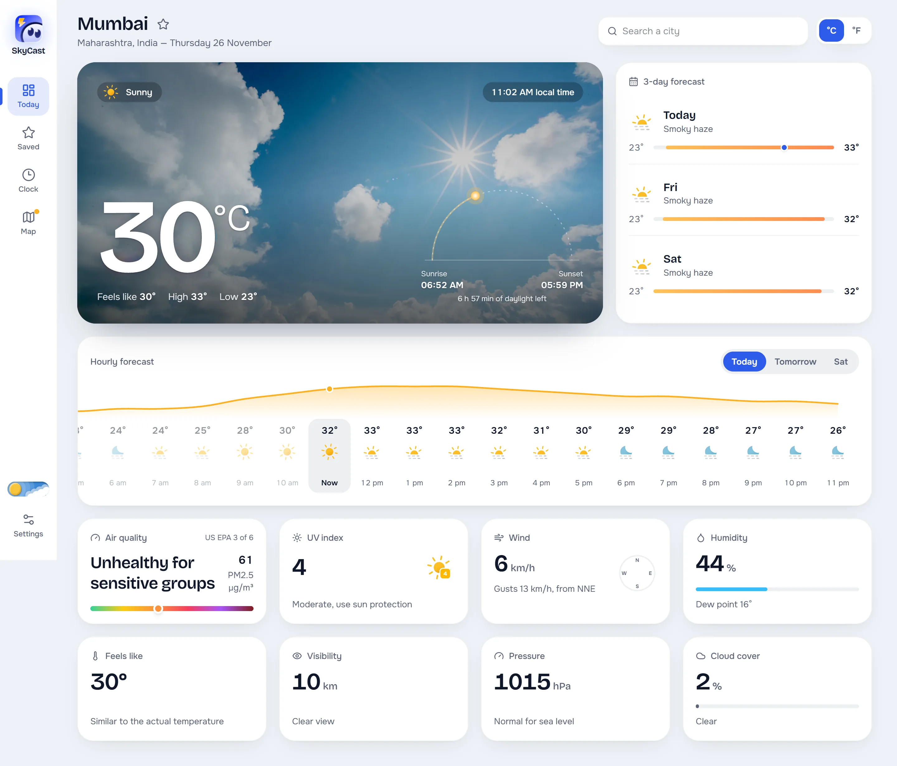

<p align="center">
  
</p>

<h1 align="center">SkyCast</h1>

<p align="center">
  Weather that looks like the sky outside. Every city gets a real photograph matched to its current conditions
  and its own local time of day.
</p>

<p align="center">
  <a href="https://sky-cast-topaz.vercel.app/"><strong>Live demo</strong></a> ·
  <a href="#getting-started">Run it locally</a> ·
  <a href="#deploying-to-vercel">Deploy</a>
</p>



<p align="center">
  
  
</p>
<p align="center"><sub>Dark mode on a clear night in Los Angeles · Mobile in a Singapore rain shower</sub></p>

## Features

- **A photo for every sky.** 13 photographs picked from WeatherAPI's condition code and the city's local time of
  day: dawn, day, golden hour, dusk or night. A clear night in Los Angeles shows stars; rain in Singapore shows
  storm clouds.
- **Today at a glance.** Current temperature, feels-like, high and low, and a daylight arc with sunrise, sunset and
  time left.
- **Hourly and 3-day forecasts.** 24 hours for today, tomorrow and the day after, plus a 3-day range view coloured by
  temperature.
- **Detail tiles.** Air quality (US EPA), UV index, wind with compass, humidity and dew point, feels-like,
  visibility, pressure and cloud cover.
- **Accurate search.** Suggestions as you type, full keyboard support, and exact-place selection, so San José,
  Costa Rica never turns into San Jose, California.
- **Saved places.** Pin up to 8 cities and see each one under its own sky and local time.
- **Clock.** A full-screen standby clock over the current weather photo.
- **Light and dark themes.** Follow your device or switch with the sun/moon toggle in the sidebar.
- **Settings.** °C or °F, km/h or mph, theme, reduced motion, and a starting city.
- **Accessible.** Visible keyboard focus, reduced motion respected, and search built as an ARIA combobox.

## Screenshots

| Saved places | Clock |
| --- | --- |
|  |  |

<details>
<summary>Full dashboard</summary>



</details>

## Tech stack

- **App:** React 19, Vite 7, Tailwind CSS 4, Motion
- **Icons:** [Meteocons](https://meteocons.com/) animated weather icons (MIT, Bas Milius) and Lucide
- **Fonts:** Bricolage Grotesque and Onest, self-hosted with Fontsource
- **Data:** [WeatherAPI.com](https://www.weatherapi.com/), free plan with a 3-day forecast
- **Hosting:** Vercel, with serverless functions for the API proxy
- **Tests:** Vitest

## Getting started

You need [Node.js](https://nodejs.org/) 20.19 or newer and a free [WeatherAPI.com](https://www.weatherapi.com/signup.aspx)
key. Keys from other weather services, such as OpenWeatherMap, won't work.

```bash
git clone https://github.com/radaxsumit/sky_cast.git
cd sky_cast
npm install
cp .env.example .env
```

Open `.env` and add your key:

```env
WEATHER_API_KEY=your_weatherapi_key
```

Start the app at http://localhost:5173:

```bash
npm run dev
```

### Scripts

| Command | What it does |
| --- | --- |
| `npm run dev` | Starts the dev server, including the local API proxy |
| `npm test` | Runs the unit tests |
| `npm run lint` | Checks the code with ESLint |
| `npm run build` | Builds the production bundle into `dist/` |

> **Tip:** add `?scene=<phase>,<code>` to the URL to preview any photo, for example `?scene=night,1195` for heavy
> rain at night. Phases are `dawn`, `day`, `golden`, `dusk` and `night`.

## Deploying to Vercel

1. Import the repository in [Vercel](https://vercel.com/new). It detects Vite automatically.
2. In **Project → Settings → Environment Variables**, add `WEATHER_API_KEY` for **Production** and **Preview**.
3. Deploy. Every push to `main` updates the live site, and every pull request gets its own preview link.

## How the API key stays private

The key never reaches the browser. The app only calls its own `/api/weather` and `/api/search` routes: Vercel
functions in `api/` in production, and a small Vite middleware (`vite-plugin-weather-proxy.js`) during
development. The proxy (`api/_lib/weatherapi.js`):

- adds the key on the server, so the Network tab never shows it or WeatherAPI's address,
- returns only the fields the app uses (about 13 KB instead of WeatherAPI's 50 KB response),
- accepts `GET` only and validates the search text,
- refuses requests from other websites, so nobody can use your key from their own page,
- limits each visitor to 60 requests a minute,
- logs key or quota problems on the server and shows visitors a plain message instead.

In the browser, identical requests already in flight are shared and forecasts are cached for 10 minutes, so the app
doesn't send duplicate calls.

## Project structure

```
api/                      Vercel functions and the shared proxy (api/_lib)
public/                   App icons and web manifest
src/
  app/                    App shell, hash routing, views: Today, Saved, Clock, Settings, Map (coming soon)
  components/             Hero, hourly, forecast, tiles, search, navigation, shared UI
  scene/                  Local time + weather → time of day and photo choice
  hooks/                  Weather loading, settings, saved places, local clock, theme, routing
  lib/                    Condition codes, icons, time, units, AQI, descriptions, cache, chart maths
  services/weatherApi.js  Calls the proxy, shares in-flight requests and caches responses
  assets/photos/          Weather photographs
tests/                    Vitest suites mirroring src/ and api/
docs/                     Screenshots, design spec and implementation plan
```

## Credits

Weather photographs are from [Unsplash](https://unsplash.com/license) and free to use:
[clear day](https://unsplash.com/photos/TSgwbumanuE),
[clear night](https://unsplash.com/photos/E0AHdsENmDg),
[partly cloudy](https://unsplash.com/photos/MSrUdvVrKEE),
[cloudy](https://unsplash.com/photos/9hIJJghBqb0),
[rain](https://unsplash.com/photos/jYjuUXgi2NU),
[rain at night](https://unsplash.com/photos/FGjR4IGwP7U),
[thunderstorm](https://unsplash.com/photos/ESL1rIs9j48),
[snow](https://unsplash.com/photos/R5SrmZPoO40),
[fog](https://unsplash.com/photos/E0e1NmVclRo),
[haze](https://unsplash.com/photos/iOrTzNpeSt8),
[dawn](https://unsplash.com/photos/vTitvl4O2kE),
[sunset](https://unsplash.com/photos/-IMlv9Jlb24) and
[cloudy night](https://unsplash.com/photos/Q-NAk1DFYkA).

Weather data by [WeatherAPI.com](https://www.weatherapi.com/).

## Author

**Sumit Prajapati** · [GitHub](https://github.com/radaxsumit) · [LinkedIn](https://www.linkedin.com/in/sumit-prajapati03/)

## License

[MIT](./LICENSE)
